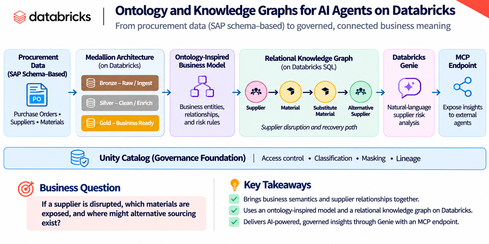
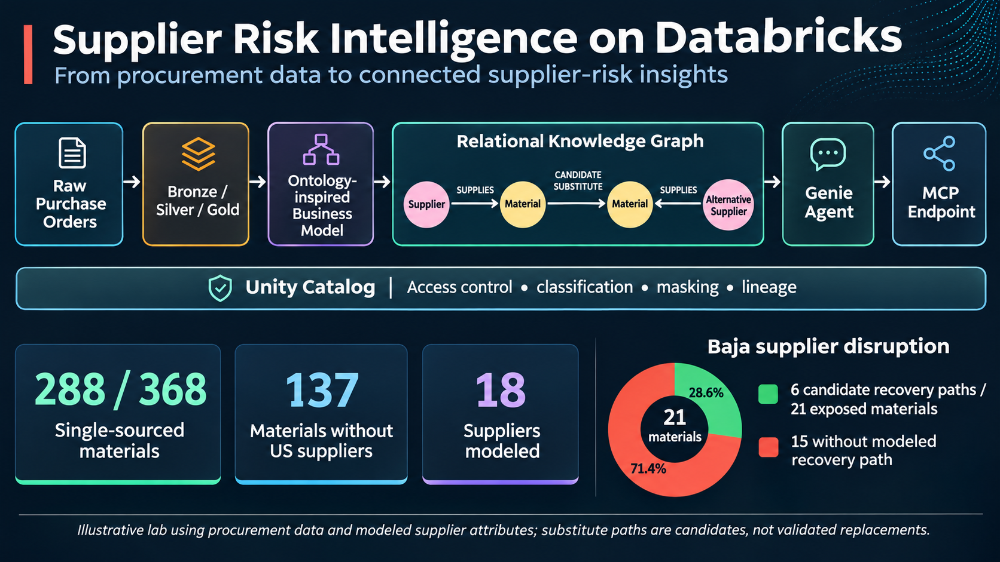

# Supplier Risk Intelligence on Databricks

An end to end lab: raw procurement data to an ontology inspired knowledge graph, served through a Genie agent and an MCP endpoint, governed in Unity Catalog.

## Run order (Databricks SQL editor)

| File | Stage | What it does |
|---|---|---|
| 01_ingest_medallion.sql | Ingest | Raw PO CSV to bronze, silver, gold via a Volume and read_files |
| 02_model_supplier_material_graph.sql | Model | Supplier dimension, PO header, supplies edges, substitute relationships |
| 03_categories_and_substitutes.sql | Model | Word boundary categories, rebuilt edges and substitutes, three hop sourcing path |
| 04_supplier_risk_queries.sql | Serve | Concentration, geographic, single point of failure, alternative sourcing |
| 05_governance.sql | Govern | Classification tags, supplier name mask, grant and lineage patterns |

Then build a Genie space on the four gold tables (kg_supplier_material, kg_substitute, lfa1_supplier, mara_material) with risk instructions, and expose it over an MCP endpoint.

## Scenario

If a supplier is disrupted, which materials are exposed, and where might alternative sourcing exist. Answered by traversing a relational knowledge graph, not aggregating a report.

## Results (verified in SQL)

- 288 of 368 materials single sourced (concentration risk)
- 137 materials with no US supplier (geographic risk)
- Single point of failure ranking across 18 suppliers
- For a disrupted supplier: materials stranded, and which have a candidate substitute with an alternate supplier

## Scope

Exploratory lab. Procurement data is public and modeled on SAP schemas (LFA1, MARA, EKKO, EKPO). Suppliers and their assignment are synthetic. Substitute paths are candidates by category, not validated replacements.
